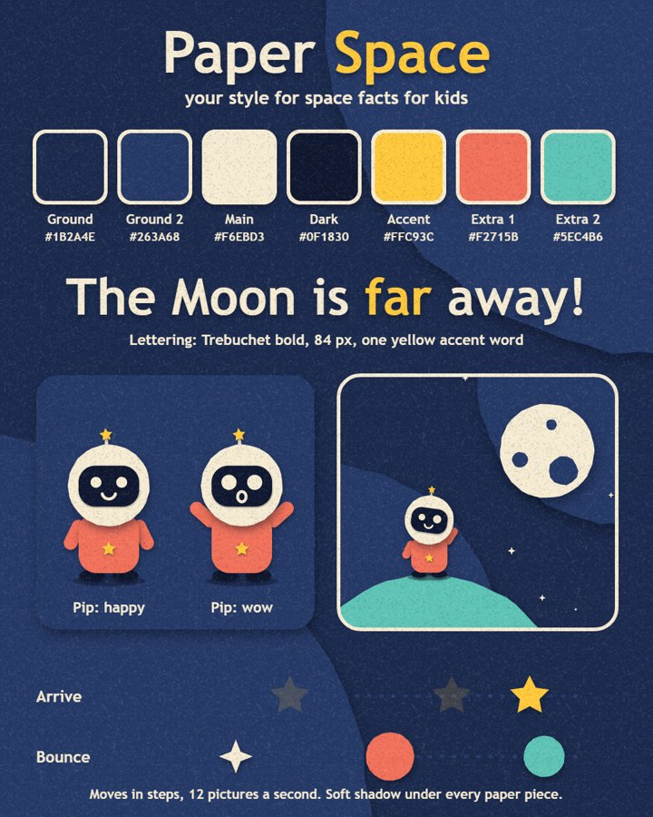
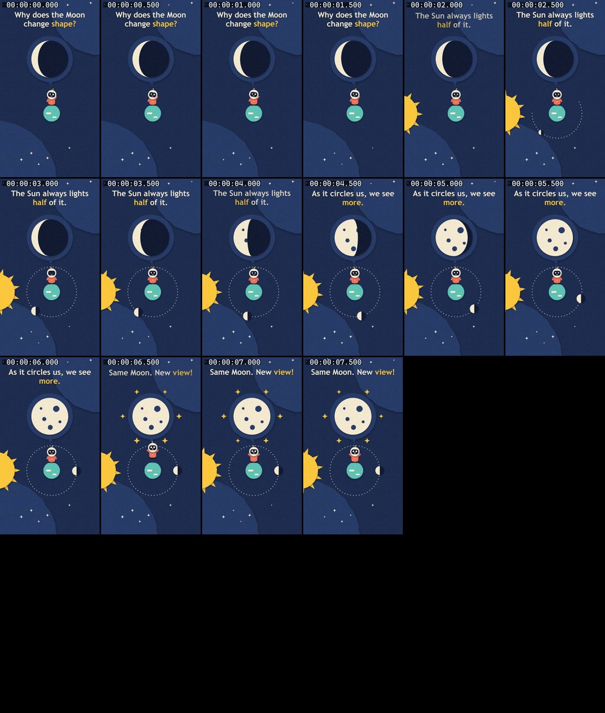
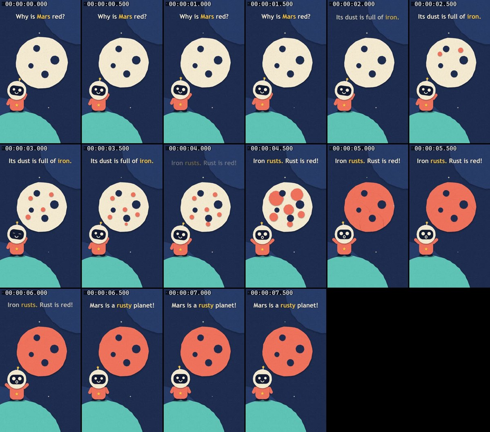
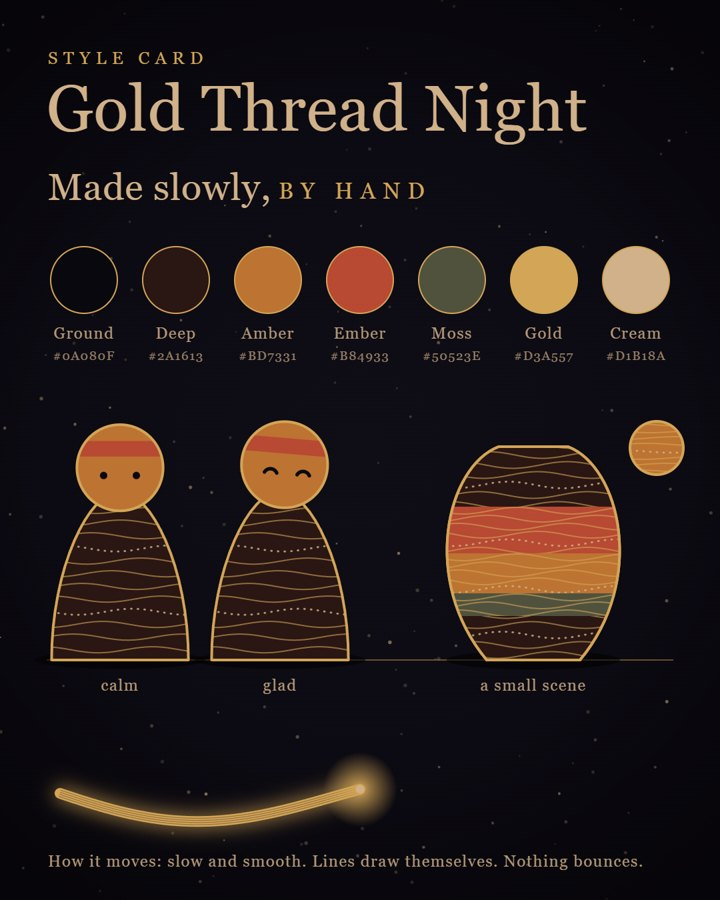
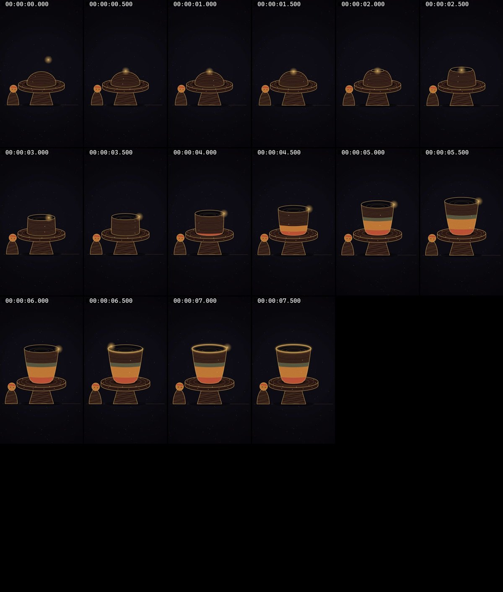

# Animation Director

A free Claude skill that makes animated videos out of code, **in your own style**.

The first time you use it, it finds your style: it copies the look of a video you love, or it designs a style for you. Then it saves that style, so every video after that looks like yours.

No camera. No editing software. You type, Claude writes the code that draws every picture.

---

## Quick start (Claude Code)

**1. Open Claude Code and pick the model.** Type `/model` and choose **Fable 5.2** (or Opus 5.5).

**2. Add the skill.** Paste this and send it:

```text
https://github.com/puneet766/ai-senseii-skills/tree/main/ANIMATION/animation-director

Install this skill in my personal skills folder.
```

Claude asks permission to save the files: say yes. If it doesn't show up, restart Claude Code.

**3. Ask for a video.**

```text
Make me an animation.
```

That's all. It takes over from there.

---

## What happens next

| Step | What the skill does | What you do |
|---|---|---|
| 1 | Asks one question: **what kind of videos do you want to make?** | Answer in a sentence. Add a video or picture you love the look of, if you have one |
| 2 | **Have an example?** It studies the frames, measures the colours, and writes down what makes the look. **No example?** It picks and designs a style for your kind of videos | Nothing |
| 3 | Shows you a **style card**: your colours, your lettering, your character, your motion | Say "go", or say what to change |
| 4 | **Saves everything** in one folder on your computer | Nothing |
| 5 | Asks what this video is about | Give one idea |
| 6 | Shows **four pictures first**, so you can fix the look while it's cheap | Say "go", or say what to change |
| 7 | Makes the whole video, records it frame by frame, **looks at its own frames and fixes what's wrong** | Wait |
| 8 | Hands you an MP4 | Post it, or ask for the next one |

From the second video on, it skips straight to step 5. Your style is already saved.

## Real examples from our tests

These came from three test runs of this exact skill, one try each, nothing touched up.

**No example given.** The user said "short videos that explain space facts for kids". The skill designed this style, then made two videos with it in two separate sessions. The second session found the saved style by itself.

| The style card it designed | Video 1: why the Moon changes shape | Video 2: why Mars is red |
|---|---|---|
|  |  |  |

**Example given.** The user gave a 20-second video they loved (night sky, thin gold lines, warm bands). The skill copied the look, not the content, and made a video about a tea cup on a potter's wheel.

| The style card it wrote | The video |
|---|---|
|  |  |

The sheets show one picture every half second.

## What gets saved

Your style lives in `.claude/animation-style/` in your home folder:

| File | What it is |
|---|---|
| `STYLE.md` | The rules in plain words: colours, shapes, lettering, character, motion, and what to never do |
| `tokens.css` | Your colours, fonts and sizes, ready for code |
| `kit.js` | Small helpers that draw your character and move things your way |
| `style-card.html` and `style-card.png` | One page that shows the whole style. Every new video is checked against it |

You can open `STYLE.md` and change anything by hand. To start over, say "make me a new style".

## Things you can say

```text
Make me an animation.
```

```text
Make a video about why cats purr.
```

```text
I love the look of this video: C:\Users\me\Downloads\example.mp4
Use it as my style.
```

```text
Make my style a bit darker, and give the character a hat.
```

```text
Make me a new style for my other page.
```

## What you need

- **Claude Code** on a computer. This is where everything works: the saved style, the MP4, and the checking.
- **A paid Claude plan.** Fable 5.2 gives the best pictures; Opus 5.5 also works.
- **Python.** The first time, Claude checks for two free tools it needs to record the video (a hidden browser and a video maker) and asks before installing them.

It also runs in the Claude chat screen, with limits: it may not be able to save your style, record the video or see its own frames there. If it can't, it says so, and gives you the style as text to paste next time.

## Tips

- **Start with 8 seconds.** Longer videos use far more of your limit.
- **Give it a change.** "A cool cat" is not an idea. "A kitten chases a red dot, and the dot becomes the sun" is.
- **Your example is for the look only.** The skill copies colours, shapes and motion. It never copies someone's characters, logo or scenes.
- **Fix by talking.** "Make the character bigger", "slower", "less text". Don't start over.

## Honest limits

- The video has **no sound**. Add voice or music in any editor.
- A first run shows one try, not the best it can ever be. Ask for another round.
- Your result won't match films other people made with other tools. Nobody can promise that.
- Making a video uses a real share of your plan's limit. The four-pictures step is there to save it.
- Tested on Windows in Claude Code. Mac and Linux use the same steps but were not tested by us.

## If something goes wrong

| Problem | Fix |
|---|---|
| "The skill isn't found" | Restart Claude Code. Check that this file exists: `.claude/skills/animation-director/SKILL.md` in your home folder |
| "NOT READY" when it checks its tools | Let it run the two install lines it shows. They are free |
| "Python is missing" | Install Python from python.org, then try again |
| The video is blank or black | Tell Claude "the video is blank". It will read the page errors and fix them |
| It forgot my style | Say "use my saved style". If the folder was deleted, it will make a new one |

## What's inside

```text
animation-director/
  SKILL.md                      the steps Claude follows
  references/style.md           how it studies an example, designs a style, and saves it
  references/looks.md           ten looks that work in code, and which fits which kind of video
  references/prompt-template.md the full prompt it writes for every video
  references/mistakes.md        what goes wrong in code-drawn animation, from real fixes
  references/example-kitten.md  a finished prompt
  scripts/capture.py            the frame-by-frame recorder, contact sheets and colour measuring
```

## Licence

MIT. Use it, change it, share it.

Made by AI Senseii. If it helped, tell me what you made.
